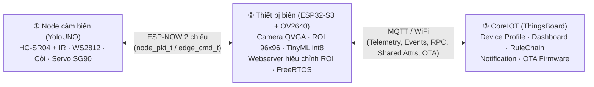

# Parking IoT – Bãi đỗ xe thông minh (Edge AI + CoreIOT)

Hệ thống **đếm chỗ trống và phát hiện đỗ xe sai vị trí** theo thời gian thực bằng **Camera + Edge AI (TinyML trên ESP32-S3)** kết hợp **Node cảm biến (YoloUNO + HC-SR04/IR)** qua **ESP-NOW** và giám sát/điều khiển/OTA trên **CoreIOT**.

> Môn Internet of Things (IoT) · Học kỳ 261 · Nhóm 3 thành viên · Nền tảng: CoreIOT + ESP32-S3 (YoloUNO)

---

## 1. Tổng quan & Kiến trúc hệ thống



### Định nghĩa "đỗ sai vị trí" (chuẩn gán nhãn thống nhất)
- **Đè vạch / chiếm 2 chỗ (`de_vach`)**: thân hoặc bánh xe nằm lên vạch phân cách giữa các ô.
- **Lệch ra ngoài ô (`ngoai_o`)**: xe nhô khỏi khung ô quá khoảng 1/4 chiều dài.
- **Đỗ trong vùng cấm (`vung_cam`)**: có xe đứng yên trong vùng lối đi quá `nopark_confirm_s` (mặc định `10 s`).

---

## 2. Cấu trúc thư mục

```text
parking-iot/
├── common/
│   ├── protocol.h          # Hợp đồng dữ liệu ESP-NOW dùng chung (cả nhóm)
│   └── README.md           # Tài liệu chuẩn gói tin, MQTT telemetry, attributes & RPC
├── node/                   # Firmware Node cảm biến & chấp hành – Người 1 (T06, N03)
├── edge/
│   ├── src/                # Firmware Thiết bị biên – chia module theo Người 1 / 2 / 3
│   ├── include/            # Sơ đồ chân camera & file cấu hình mẫu
│   └── partitions_16MB_ota.csv
├── ml/                     # Pipeline thu ảnh, gán nhãn, train & export int8 – Người 2 (T05)
├── coreiot/                # RuleChain, Dashboard, Shared Attributes, hướng dẫn OTA – Người 3
├── docs/                   # Kịch bản thử nghiệm (10 kịch bản), sơ đồ, ảnh minh chứng
└── README.md
```

Chi tiết từng phân hệ:
- [common/README.md](common/README.md) – Hợp đồng dữ liệu (`protocol.h`, Telemetry, Shared Attributes, RPC)
- [node/README.md](node/README.md) – Firmware Node YoloUNO (siêu âm, IR, ESP-NOW, LED/Còi/Servo, LVGL)
- [edge/README.md](edge/README.md) – Firmware Thiết bị biên ESP32-S3-CAM (Camera, Webserver, AI, Logic, MQTT, OTA)
- [ml/README.md](ml/README.md) – Công cụ thu thập, gán nhãn, huấn luyện & export TFLite int8
- [coreiot/README.md](coreiot/README.md) – Cấu hình CoreIOT (Device Profile, Dashboard, RuleChain, Notification, OTA)
- [docs/README.md](docs/README.md) & [docs/test_scenarios.md](docs/test_scenarios.md) – Kịch bản kiểm thử & minh chứng

---

## 3. Phân công & Yếu tố tính điểm

| Mã | Yếu tố công nghệ – hiện thực | Điểm | Chính | Hỗ trợ | Thư mục / File chính |
|---|---|---:|---|---|---|
| **T06** | ESP-NOW 2 chiều giữa node và thiết bị biên | 1.5 | Người 1 | Người 2 | `node/`, `edge/src/espnow.cpp` |
| **T07** | Webserver trên thiết bị biên (ảnh, vẽ ROI, trạng thái, barrier) | 1.0 | Người 1 | — | `edge/src/web.cpp`, `edge/src/camera.cpp` |
| **T05** | Công cụ thu ảnh + gán nhãn theo ô, huấn luyện, export int8 | 1.0 | Người 2 | Người 1 | `ml/` |
| **T04** | Suy luận TinyML trên ESP32-S3 + logic vi phạm & cảm biến | 1.0 | Người 2 | — | `edge/src/ai.cpp`, `edge/src/logic.cpp` |
| **T11** | Device profile, dashboard sơ đồ bãi + bảng vi phạm, RPC | 1.0 | Người 3 | Người 2 | `coreiot/dashboard.json`, `edge/src/mqtt.cpp` |
| **T12** | RuleChain: bãi đầy → đóng barrier; kéo dài → Critical; offline | 1.0 | Người 3 | — | `coreiot/rulechain.json` |
| **T13** | Notification khi đỗ sai vị trí, bãi đầy, thiết bị offline | 0.5 | Người 3 | — | `coreiot/README.md` |
| **T14** | Cập nhật firmware OTA qua CoreIOT (kèm cập nhật model mới) | 2.0 | Người 3 | Người 2 | `edge/src/ota.cpp` |
| **N03** | *(Điểm cộng)* Màn hình LVGL ở cổng: chỗ trống + ô vi phạm | +1.0 | Người 1 | — | `node/` |

---

## 4. Quy trình Git & Quy ước Commit

### Nhánh làm việc
- `main`: mã nguồn ổn định đã tích hợp, chỉ merge qua **Pull Request**.
- `node-cam`: nhánh phát triển của **Người 1** (`node/`, `edge/src/camera.*`, `edge/src/web.*`, `edge/src/espnow.*`).
- `edge-ml`: nhánh phát triển của **Người 2** (`ml/`, `edge/src/ai.*`, `edge/src/logic.*`, `edge/src/mqtt.*`, `edge/src/main.cpp`).
- `coreiot`: nhánh phát triển của **Người 3** (`coreiot/`, `edge/src/ota.*`, `docs/`).

### Quy tắc
1. **Không tự ý sửa `common/protocol.h`** nếu chưa thống nhất với cả nhóm.
2. **Commit nhỏ, thường xuyên, message rõ ràng** theo dạng `<scope>: <mô tả>`:
   - `node: add median filter for ultrasonic sensors`
   - `edge: add ROI crop + resize to 96x96`
   - `ml: split train/test by capture session`
   - `coreiot: add Parking Logic rulechain export`
3. **Không commit thông tin nhạy cảm** (`config.h` chứa WiFi/Token) hoặc **dataset ảnh lớn** (`ml/data/raw/`).

---

## 5. Dataset & Video Demo

- **Dataset ảnh thu thập (Google Drive)**: *(Cập nhật link Google Drive tại đây sau khi thu đợt 1 & đợt 2)*
- **Video demo (5–10 phút)**: *(Cập nhật link video tại đây vào Tuần 15–16)*

---

## 6. Mốc thời gian thực hiện

| Tuần | Người 1 | Người 2 | Người 3 |
|---:|---|---|---|
| **11** | Chốt board camera, tạo repo, dựng mô hình bãi + giá camera | Chốt `protocol.h` & định nghĩa nhãn | Khởi tạo kế hoạch, chuẩn bị CoreIOT |
| **12** | Camera chạy, `/capture`, node đọc cảm biến, thử ESP-NOW | `collect.py`, `label_tool.py`, thu & gán nhãn đợt 1, train thử | Device profile, token, dashboard đầu, thử OTA sketch tối giản |
| **13** | Webserver vẽ ROI, ESP-NOW 2 chiều, LED/còi/servo | Thu đợt 2, export int8, suy luận ESP32-S3, logic, MQTT, RPC | RPC widget, RuleChain, Notification, viết Giới thiệu + Phân tích |
| **14** | Ghép toàn hệ thống, sửa lỗi, LVGL (nếu kịp) | Ghép toàn hệ thống, re-train với ảnh thực tế | Ghép OTA vào firmware edge, sửa lỗi |
| **15** | Chạy 10 kịch bản đo đạc, quay video, viết báo cáo & README | Chạy 10 kịch bản, quay video, viết báo cáo & README | Dựng video, hoàn thiện báo cáo & README |
| **16** | Rà soát repo/commit, báo cáo & nộp LMS | Rà soát repo/commit, báo cáo & nộp LMS | Điều phối ghép báo cáo `[Mã lớp]_[Mã nhóm]_BaoCaoIoT.pdf` & nộp LMS |

---

## 7. Tài liệu tham khảo & Ghi nhận công cụ / AI

- Espressif `esp32-camera` & ví dụ `CameraWebServer` (Arduino-ESP32).
- ThingsBoard / CoreIOT MQTT API & OTA Firmware Update SDK.
- TensorFlow Lite for Microcontrollers (`Chirale_TensorFlowLite` / Edge Impulse EON).
- **Phạm vi sử dụng AI hỗ trợ**: *(Ghi rõ công cụ và phần việc được AI hỗ trợ theo yêu cầu bài tập lớn trước khi nộp).*
